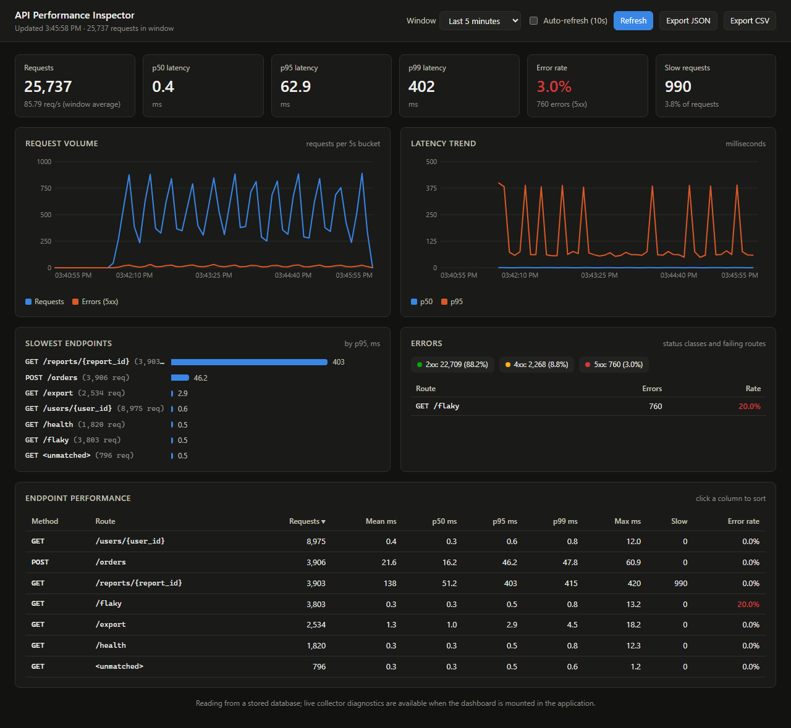
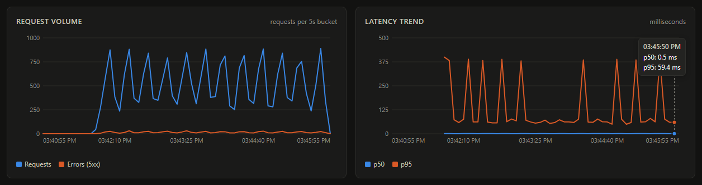
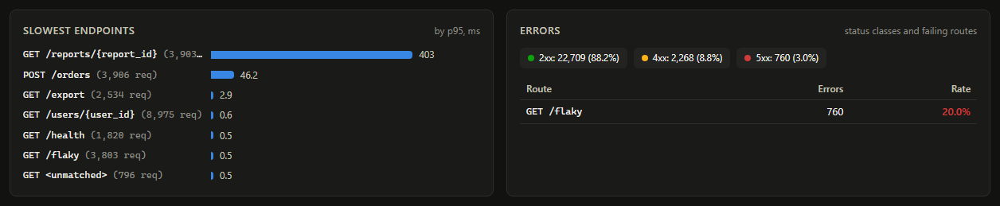
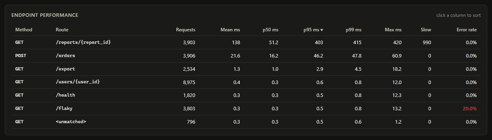
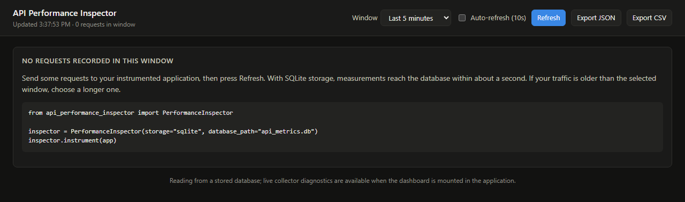

# API Performance Inspector

Local, self-contained latency profiling for FastAPI applications.

Add two lines to a FastAPI app and every HTTP request is timed and grouped by route
template. You can then see request counts, p50/p95/p99 latency, slow requests and error
rates per endpoint in a local dashboard, from the command line, or as JSON/CSV. There is
no Prometheus, Grafana, agent or hosted service to set up: measurements are kept in memory
or in a SQLite file next to your app.

It is meant for developers who want to know which endpoints are slow while building,
load-testing or debugging an API, without first deploying an observability stack.



*The dashboard after about 25,700 requests from `examples/generate_traffic.py` against
`examples/basic_app.py`. Every number is a real measurement.*

## Why

Ask "which endpoint got slow?" and you usually end up with one of two answers. Wrap
handlers in ad-hoc `time.perf_counter()` calls and print the results, or run a full
metrics pipeline (an exporter, Prometheus, Grafana) before you can see a single
percentile. The first gives you averages for one route at a time. The second is a lot of
infrastructure for a laptop or a staging box.

This tool sits in between. It is one ASGI middleware that records a few fields per
request, plus a small dashboard and CLI that compute percentiles from those raw samples.
It answers practical questions directly:

- `GET /reports/{report_id}` has a p50 of 51 ms but a p95 of 403 ms. Which requests are
  the slow ones, and how many?
- After a change, did `POST /orders` get slower, or is it the same route but more traffic?
- Which route produces the 5xx errors, and at what rate?

## Features

- **One-call instrumentation** of any FastAPI app through pure ASGI middleware. Request
  and response bodies, status codes and streaming are untouched.
- **Route templates, not URLs.** `/users/1` and `/users/2` are both counted as
  `GET /users/{user_id}`. Query strings, headers and bodies are never stored.
- **Latency statistics** per endpoint and overall: count, mean, min, max, p50, p95 and
  p99, computed exactly from the retained samples.
- **Slow-request detection** against a configurable threshold.
- **Error tracking:** 5xx responses and unhandled exceptions per route, plus a 2xx/3xx/4xx/5xx
  breakdown.
- **Two storage modes:** a bounded in-memory buffer, or SQLite written by a background
  thread so the event loop never waits on disk.
- **Local dashboard** with request-volume and latency charts, a slowest-endpoints view, an
  error breakdown and a sortable endpoint table.
- **CLI** (`dashboard`, `summary`, `export`) and **JSON/CSV export**.
- **Python API:** `inspector.summary()` and `inspector.diagnostics()`.

## Installation

Requirements: Python 3.11 or newer. The only runtime dependencies are `fastapi` and
`uvicorn`. The package is **not published on PyPI**. Install it from GitHub or from a
local build.

From GitHub, into your project's virtual environment:

```bash
pip install "git+https://github.com/xorh02/api-performance-inspector.git"
```

From a clone (this also gives you the examples used below):

```bash
git clone https://github.com/xorh02/api-performance-inspector.git
cd api-performance-inspector
python -m venv .venv
```

```bash
# Windows (PowerShell)
.venv\Scripts\Activate.ps1
# macOS / Linux
source .venv/bin/activate
```

```bash
pip install .
```

As a wheel, for example to install it into another environment offline:

```bash
pip install build
python -m build                  # writes dist/api_performance_inspector-0.1.0-py3-none-any.whl
pip install dist/api_performance_inspector-0.1.0-py3-none-any.whl
```

Check the installation:

```console
$ api-performance-inspector --version
api-performance-inspector 0.1.0
```

## Quick start

From a clone with the package installed (see above), start the demo app. It listens on
`http://127.0.0.1:8000` and records to `./api_metrics.db`:

```bash
python examples/basic_app.py
```

In a second terminal with the same virtual environment active, send 1,000 requests and
print a summary:

```console
$ python examples/generate_traffic.py
Sent 1000 requests; status codes: {200: 873, 404: 99, 500: 28}
Client-observed latency ms: p50 5.7  p95 76.1  p99 406.9

$ api-performance-inspector summary
Window: last 3600s (2026-11-07T06:47:39.665+00:00 to 2026-11-07T07:47:39.665+00:00)
Requests: 1000  Errors: 28 (2.80%)  Slow: 39  Avg throughput: 0.278 req/s
Latency ms  p50 0.4  p95 60.0  p99 398.1  mean 23.8  max 423.5

METHOD  ROUTE                                      COUNT      P50      P95      P99   ERR%
GET     /reports/{report_id}                         143     48.6    406.0    415.1   0.0%
POST    /orders                                      144     15.1     45.0     47.3   0.0%
GET     /export                                       98      1.2      4.3     16.9   0.0%
GET     /users/{user_id}                             357      0.3      0.5      0.7   0.0%
GET     /health                                       85      0.3      0.5      0.9   0.0%
GET     /flaky                                       143      0.3      0.4      0.6  19.6%
GET     <unmatched>                                   30      0.2      0.4      0.4   0.0%
```

The request mix is seeded and the demo's failures are deterministic, so on a fresh
database you get the same status codes and per-route counts. Latencies depend on your
machine. Then open the dashboard and visit <http://127.0.0.1:8765/>:

```bash
api-performance-inspector dashboard
```

Press `Ctrl+C` in each terminal to stop. Delete `api_metrics.db` to start over.

## Use it in your own project

[`examples/inventory_service/app.py`](examples/inventory_service/app.py) is an ordinary
FastAPI service (dependencies, Pydantic models, a deliberately slow search endpoint) that
uses this package only through its installed public API. The integration is the last
block of the file:

```python
from api_performance_inspector import PerformanceInspector

app = FastAPI(title="Inventory service")
# ... your routes, unchanged ...

# Performance instrumentation. Set INVENTORY_PROFILING=0 to run without it.
if os.environ.get("INVENTORY_PROFILING", "1") != "0":
    inspector = PerformanceInspector(
        storage="sqlite",
        database_path="inventory_metrics.db",
        slow_request_threshold_ms=100,
        exclude_paths=["/healthz"],
    )
    inspector.instrument(app)
```

Step by step:

1. **Install** the package into your app's environment (see [Installation](#installation)).
2. **Create one `PerformanceInspector`** and call `instrument(app)` once, at import time,
   before the app starts serving. Routes can be declared before or after.
3. **Run your app as usual**, for example `uvicorn app:app`. Nothing else changes.
   Measurements are written to `inventory_metrics.db` in the working directory.
4. **View the results** from another terminal:
   `api-performance-inspector dashboard --db inventory_metrics.db`, or `summary`/`export`
   with the same `--db`.
5. **Customise** with the options in [Configuration](#configuration): threshold,
   storage, excluded paths and retention.
6. **Disable or remove it.** If `instrument()` is not called, the app runs exactly as
   before, so guard the call with your own setting as above. With `INVENTORY_PROFILING=0`
   no middleware is added and no database is created. To remove the integration, delete
   the block and uninstall the package.

If you would rather not keep a file, use memory storage and mount the dashboard inside the
app. This is an explicit opt-in because it serves the dashboard on your app's port with
no authentication:

```python
inspector = PerformanceInspector()  # storage="memory"
inspector.instrument(app, dashboard_path="/_inspector")
# http://127.0.0.1:8000/_inspector/ ; paths under /_inspector are not measured
```

### Verifying the integration end to end

[`examples/inventory_service/check.py`](examples/inventory_service/check.py) proves this
works from outside the repository. It serves `app.py` with uvicorn on a free local port,
sends 43 real HTTP requests, shuts the server down gracefully (which flushes the SQLite
writer), then reads the results back through the installed CLI. To run it against a
freshly built wheel in a separate directory, from the repository root in a bash shell
(Git Bash on Windows). These are the same commands CI runs:

```bash
python -m build
WHEEL="$PWD/$(ls dist/*.whl)"
mkdir ../consumer-check && cp examples/inventory_service/*.py ../consumer-check/
cd ../consumer-check
python -m venv .venv
if [ -x .venv/bin/python ]; then PY=.venv/bin/python; else PY=.venv/Scripts/python.exe; fi
$PY -m pip install "$WHEEL"
$PY check.py --require-installed
```

The run below is from that exact setup on Windows:

```text
api_performance_inspector 0.1.0 from C:\...\consumer-check\.venv\Lib\site-packages\api_performance_inspector\__init__.py
ok    package is imported from an installation
sent 43 requests
ok    server shut down gracefully

$ api-performance-inspector summary --db inventory_metrics.db
Window: last 3600s (2026-11-07T06:50:28.654+00:00 to 2026-11-07T07:50:28.654+00:00)
Requests: 33  Errors: 0 (0.00%)  Slow: 5  Avg throughput: 0.009 req/s
Latency ms  p50 14.7  p95 160.2  p99 170.6  mean 37.4  max 171.1

METHOD  ROUTE                                      COUNT      P50      P95      P99   ERR%
GET     /search                                        5    153.9    170.8    171.0   0.0%
GET     /items/{sku}                                  25     14.7     16.2     62.6   0.0%
PUT     /items/{sku}                                   3      0.6      1.5      1.6   0.0%

ok    responses were unaffected
ok    validation errors were returned unchanged
ok    33 requests recorded (/healthz excluded)
ok    path parameters grouped
ok    404s recorded under their route
ok    422s recorded
ok    slow /search requests flagged
ok    fast requests not flagged
ok    query string values were not stored
all checks passed
```

CI runs the same check on every push against the wheel it builds. The test suite also
runs it against the development install.

## Feature walkthrough

All screenshots come from the dashboard reading the demo app's database, after about four
minutes of seeded traffic from `generate_traffic.py`.

### Overview: counts, percentiles and what they mean

The top row covers the selected window (5 minutes to 24 hours, or all retained data).

- **p50** is the median: half of requests were faster.
- **p95** and **p99** show the tail: 1 request in 20 (or 100) was slower than this. A
  large gap between p50 and p95 means most requests are fast but some are much slower.
  That is exactly what an average hides.
- **Error rate** counts 5xx responses and unhandled exceptions. 4xx responses are client
  errors and are shown separately in the status breakdown.
- **Slow requests** took longer than `slow_request_threshold_ms`.

In the screenshot at the top, the overall p50 is 0.4 ms but p99 is 402 ms. The cause
is one route.

### Request volume and latency over time



Requests and 5xx errors per time bucket, plus p50 and p95 per bucket. The bucket size
adapts to the window, so a chart never has more than about 60 points. Hovering shows the
exact values. The p95 spikes line up with the quieter traffic waves: with fewer requests
per bucket, the slow `/reports` calls make up a larger share of each bucket's tail.

### Slowest endpoints and errors



Endpoints are ranked by p95 and shown with request counts, because a p95 from 5 requests
means much less than one from 5,000. The errors panel shows the status-class split and the
routes producing 5xx responses. Here `GET /flaky` fails every fifth call by design (20.0%).

### Endpoint table



Every method and route with requests, mean, p50, p95, p99, max, slow count and error
rate. Click any column to sort (here by p95). `/reports/{report_id}` has a p50 of 51 ms
but a p95 of 403 ms. The demo sleeps 400 ms for report ids divisible by 4, and those
calls account for all 990 slow requests. `<unmatched>` groups requests to paths that no
route matched (404s), without recording the paths themselves.

A note on the demo's numbers on Windows: asyncio's timer resolution there is about
15.6 ms, and on a busy event loop a timer due within one tick fires early. The demo's
`asyncio.sleep(0.01)` calls in `/export` therefore often take close to 0 ms, and the
30 ms sleep in `/orders` measures about 15 ms. The inspector reports the time that
actually elapsed. (Measured on this machine with a busy loop: `sleep(10 ms)` took 0 ms,
`sleep(30 ms)` took 15.5 ms and `sleep(60 ms)` took 46.8 ms.) Platforms with a
fine-grained monotonic clock, such as Linux, are not affected in the same way.

### Empty state



With no requests in the window, the dashboard says so and shows the integration snippet
instead of empty charts.

### Command line

```text
api-performance-inspector dashboard [--db PATH] [--host 127.0.0.1] [--port 8765] [--max-samples N]
api-performance-inspector summary   [--db PATH] [--window 1h] [--max-samples N]
api-performance-inspector export    [--db PATH] [--format json|csv] [--window all] [-o FILE] [--max-samples N]
```

`--db` defaults to `./api_metrics.db`, the same default as `PerformanceInspector`.
`--window` takes seconds or `30s`, `15m`, `1h`, `7d` or `all`. Exit codes: `0` success,
`1` runtime failure (unwritable output file, dashboard port already in use, or output
piped into a command that exited early), `2` invalid arguments or a missing or unreadable
database. The dashboard binds to `127.0.0.1` and warns if you bind it to anything else.

### Export

The dashboard's Export buttons and `api-performance-inspector export` produce the same
data. CSV has one row per request (real output):

```text
timestamp_utc,timestamp_unix,method,route,status,duration_ms,error,slow
2026-11-07T07:41:53.795254+00:00,1794037313.795254,GET,/flaky,200,0.913,0,0
2026-11-07T07:41:53.796758+00:00,1794037313.796758,GET,/export,200,11.888,0,0
2026-11-07T07:41:53.807999+00:00,1794037313.807999,POST,/orders,200,13.044,0,0
```

JSON contains `schema_version`, a `summary` (the same structure as the dashboard's
`/api/summary`: `window`, `overview`, `status_classes`, `methods`, `endpoints`,
`timeseries`) and the same per-request `measurements`. Latency fields end in `_ms`, and
rates are fractions from 0 to 1. One endpoint entry from the demo:

```json
{
  "method": "GET",
  "route": "/reports/{report_id}",
  "requests": 3903,
  "errors": 0,
  "error_rate": 0.0,
  "slow_requests": 990,
  "mean_ms": 138.178,
  "min_ms": 30.625,
  "max_ms": 420.16,
  "p50_ms": 51.22,
  "p95_ms": 402.766,
  "p99_ms": 415.355,
  "status_classes": {"2xx": 3903}
}
```

Both formats load directly into pandas, a spreadsheet or `sqlite3`. The SQLite file
itself has a single `measurements` table with the CSV columns.

### Python API

The same statistics are available in-process, which is handy in tests or scripts. This
is real output after 50 requests to `GET /users/{user_id}`:

```python
>>> inspector.summary(window_seconds=300)["overview"]
{'requests': 50, 'errors': 0, 'error_rate': 0.0, 'slow_requests': 0, 'requests_per_second': 0.167,
 'mean_ms': 0.37, 'min_ms': 0.267, 'max_ms': 1.395, 'p50_ms': 0.335, 'p95_ms': 0.514, 'p99_ms': 1.031}
>>> inspector.diagnostics()
{'recorded': 50, 'routes_tracked': 1, 'routes_overflowed': 0, 'internal_errors': 0,
 'last_internal_error': None, 'storage': 'memory', 'retained_samples': 50}
```

`diagnostics()` is how you find out whether the collector is losing data. In SQLite mode
it also reports `written`, `dropped`, `failed_writes`, `queue_depth` and `last_error`. A
mounted dashboard shows the same information in its footer.

## Configuration

All options are keyword arguments to `PerformanceInspector`. None is required. Values
are validated when the object is created. Invalid values raise
`api_performance_inspector.ConfigError` naming the option, for example
`ConfigError: slow_request_threshold_ms must be a positive number, got 0`.

| Option | Default | Description |
| --- | --- | --- |
| `storage` | `"memory"` | `"memory"` or `"sqlite"`. |
| `database_path` | `"api_metrics.db"` | SQLite file, relative to the working directory. Its directory must exist; the schema is created automatically. |
| `slow_request_threshold_ms` | `500` | Requests longer than this are flagged as slow. The flag is stored with each measurement. |
| `max_samples` | `100000` | Memory: measurements kept (oldest evicted). SQLite: row cap applied by cleanup. |
| `retention_seconds` | `604800` (7 days) | SQLite: rows older than this are deleted by a cleanup that runs every 60 s. |
| `exclude_paths` | `()` | Paths not measured, matched exactly or as a prefix at a `/` boundary, e.g. `["/healthz", "/static"]`. |
| `max_routes` | `500` | Distinct route labels tracked; further routes are grouped as `<other>`. |
| `queue_size` | `10000` | SQLite: write-queue capacity. When it is full, new measurements are dropped and counted. |

`instrument(app, dashboard_path=None)` takes one option: the path at which to mount the
dashboard inside the app (off by default). The package reads no environment variables.

Common mistakes:

- **Calling `instrument()` after the app has started.** Starlette rejects new middleware
  then. Call it at import time.
- **Calling it twice on the same app.** This raises `ConfigError` rather than counting
  every request twice.
- **A `database_path` whose directory does not exist** raises `ConfigError` at startup.
- **The CLI reading a different file than the app writes.** The CLI resolves `--db`
  relative to *its own* working directory.
- **Memory mode with several workers.** Each worker has its own data, and a mounted
  dashboard shows only the worker that served it. Use SQLite and the CLI dashboard
  instead.

## How it works

```text
request -> InspectorMiddleware (ASGI) -> PerformanceInspector._record -> store.add()
                                                                            |
               MemoryStore: bounded deque        SQLiteStore: bounded queue -> writer thread -> SQLite (WAL)
                                                                            |
     dashboard / CLI / export  <-  metrics.summarize()  <-  store.query(since)
```

- **Timing.** The middleware records `time.perf_counter_ns()` when the request reaches
  it and again after the final `http.response.body` message (the one with
  `more_body=False`) has been handed to the server, so a streamed response is measured to
  completion. It is added as the outermost user middleware, so the measurement covers
  routing, dependencies, the endpoint, exception handlers and any middleware added before
  it. It does not include time spent inside uvicorn or on the network. That is why the
  demo's client-observed p50 (5.7 ms) is higher than the server-side p50 (0.4 ms).
- **Exactly one measurement per request.** WebSocket and lifespan traffic pass straight
  through. If the app raises before sending a response, the request is recorded as
  status 500 with `error=1`, and the original exception is re-raised unchanged.
- **Route labels** come from the `APIRoute` that FastAPI stores in the ASGI scope, with
  any mount prefix added back. Labels are capped at `max_routes`, and non-standard HTTP
  methods become `OTHER`, so clients cannot create unbounded label sets.
- **Never blocking, never breaking a request.** `store.add()` does not block or raise.
  The SQLite writer drains the queue in batches of up to 1,000 rows, at least every
  0.5 s, in its own thread and connection. On ASGI lifespan shutdown, or at interpreter
  exit, pending rows are flushed within a 5-second timeout. Any recording or storage
  failure is logged on the `api_performance_inspector` logger and counted in
  `diagnostics()`.
- **Exact percentiles from raw samples.** Each sample is a small tuple, and statistics
  are computed when you read them, not pre-aggregated into histograms. Percentiles use
  linear interpolation between closest ranks (Hyndman & Fan type 7, the default in NumPy
  and `statistics.quantiles(method="inclusive")`): the value at fractional rank
  `(n - 1) * p` of the sorted samples. The tests check this against the standard library.
  Aggregating 100,000 samples takes about 0.2 s on the machine used for the benchmark.
- **Bounded memory.** Memory mode keeps at most `max_samples` samples. Reads from SQLite
  return at most the newest `max_samples` rows. If a window holds more, the dashboard
  and `summary` say so instead of silently presenting partial data as complete.
- **Throughput** ("req/s, window average") is the request count divided by the window
  length. The volume chart shows the per-bucket rate.

## Testing and reproducibility

```bash
pip install -e ".[dev]"
pytest                   # 105 tests: unit, dashboard, CLI and integration
ruff check . && ruff format --check .
mypy                     # strict, on src/
python -m build
```

The integration tests start the demo app and the inventory service under real uvicorn
servers on free local ports and send real HTTP requests. Timing-sensitive behaviour, such
as streaming duration and the slow threshold, is tested with a controlled clock instead
of sleeps.

To reproduce the screenshots, run the quick start, generate a few minutes of traffic (for
example, repeat `generate_traffic.py` with different `--seed` and `--concurrency`
values), and open the dashboard with the "Last 5 minutes" window.

### Overhead benchmark

[`benchmarks/overhead.py`](benchmarks/overhead.py) measures what the instrumentation
costs. It drives the same minimal app (one `GET /items/{item_id}` endpoint) directly
through ASGI, with no network or HTTP client, in three configurations: uninstrumented,
memory and SQLite. The configurations are interleaved after a warm-up, and the median of
5 repeats is reported.

```bash
python benchmarks/overhead.py --requests 20000 --concurrency 50 --repeats 5
```

One run on Windows 11, CPython 3.12.16, an Intel x86-64 CPU with 24 logical cores, on an
otherwise idle machine:

| Configuration | Median µs per request | Requests/s | Added cost |
| --- | ---: | ---: | ---: |
| Baseline (no instrumentation) | 42.4 | 23,593 | – |
| Memory storage | 48.6 | 20,557 | +6.3 µs (+14.8%) |
| SQLite storage | 51.1 | 19,588 | +8.7 µs (+20.4%) |

"µs per request" is wall time divided by requests completed at concurrency 50. It
measures inverse throughput, not latency. Across repeated runs on this machine the added
cost was 5 to 9 µs per request when the machine was quiet. One run with other work in
progress measured 17 to 21 µs. On a trivial in-process endpoint that is a 10 to 20%
slowdown. For endpoints that do real I/O, or behind a network round trip, it is small.
Run the benchmark on your own hardware before relying on these figures.

## Limitations

- **Local, per-process data.** This is not a distributed metrics system. With several
  workers, use SQLite: each worker writes to the same file (WAL mode, busy timeout), which
  suits development and modest traffic. Very high request rates need a larger
  `queue_size` or a dedicated metrics pipeline.
- **Retained window, not lifetime.** Statistics cover the retained samples in the selected
  window. Memory mode loses everything on restart, and the `diagnostics()` counters reset.
- **Data loss is possible.** Measurements are dropped (and counted) when the SQLite queue
  is full, and queued rows are lost if the process is killed or the shutdown flush times
  out. Right after a writer process is killed on Windows, a read can fail once with
  `disk I/O error` while the OS releases file locks. The next read succeeds.
- **Route labels.** Plain Starlette routes (`app.add_route`) are labelled `<unresolved>`.
  Mounted non-FastAPI apps such as `StaticFiles` are grouped as `<prefix>/{path}`. Mount
  prefixes that contain path parameters use the actual values.
- **No tracing.** There are no per-dependency or database-query timings, no distributed
  traces and no alerting.
- **Clocks.** Durations use a monotonic clock. Chart timestamps use the wall clock, so
  changing the system time moves where requests appear.
- **Platforms.** Developed and tested on Windows 11 with Python 3.11, 3.12 and 3.13. The
  CI workflow also runs everything on Ubuntu. macOS has not been tested.

## Security and privacy

Per request, only these fields are stored: start time, method, route template, status
code, duration and the error/slow flags. Raw URLs, query strings, headers (including
`Authorization` and cookies), client addresses, and request or response bodies are never
read or stored. The tests send secrets in each of those places and check that they do
not appear in the dashboard API or the exports.

The dashboard has no authentication. The CLI serves it on `127.0.0.1` by default, and
mounting it inside your app requires an explicit `dashboard_path`. Its pages send a
restrictive Content-Security-Policy, render all text with `textContent`, serve static
files only from the package directory, and load nothing from the internet. All SQL is
parameterised.

## Contributing

Issues and pull requests are welcome. For anything beyond a small fix, please open an
issue first so the approach can be discussed. Before submitting, run `pytest`,
`ruff check .`, `ruff format --check .` and `mypy`, and add tests for the behaviour you
change. The project tries to stay small, so new dependencies and options need a clear
reason.

## License

MIT. See [LICENSE](LICENSE).
